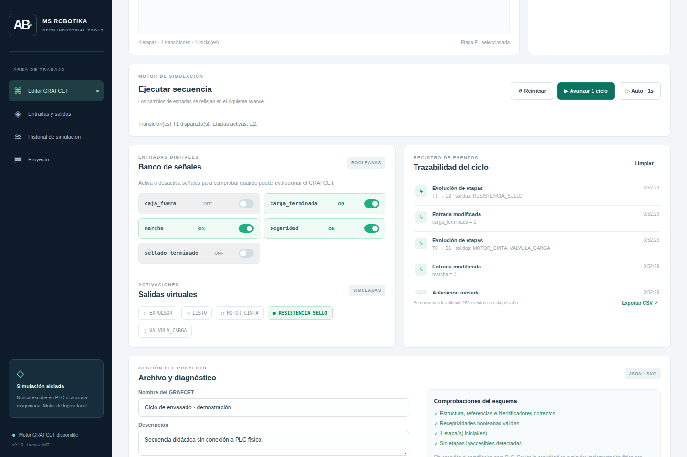
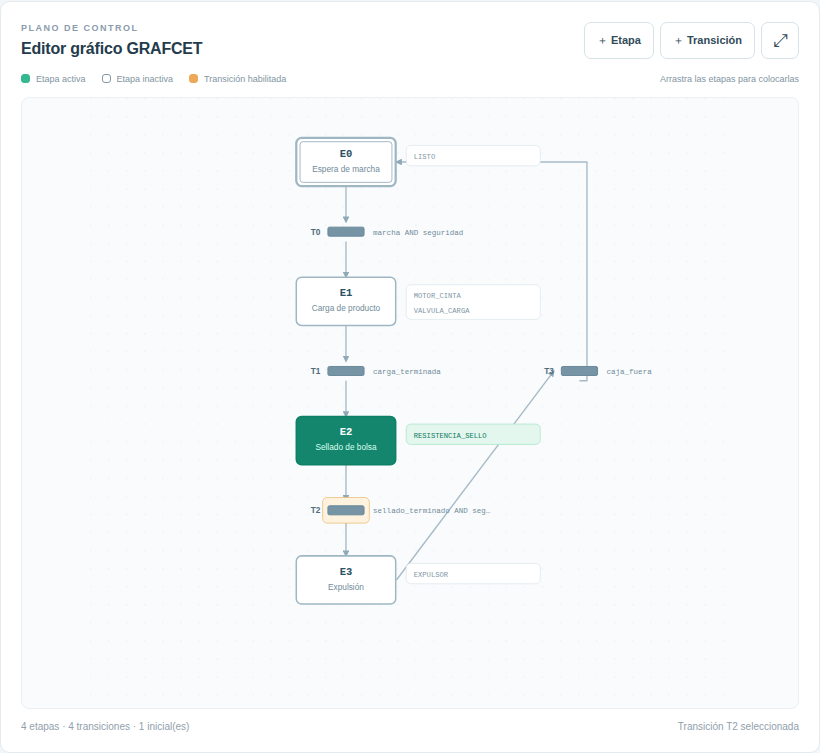
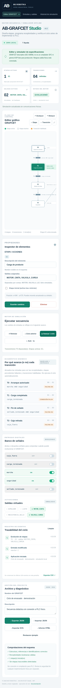

# AB-GRAFCET Studio · MS ROBOTIKA

**v0.1 alfa · Editor y simulador GRAFCET en español · MIT · 100% local**

Esta es una **rama pública provisional** del programa independiente, mientras se crea el repositorio `msrobotika/AB-GRAFCET-Studio`. No se ha modificado la rama principal del perfil.

## Abrir la aplicación

- **[AB-GRAFCET-Studio-PORTABLE.html](AB-GRAFCET-Studio-PORTABLE.html)**: descarga y abre el archivo HTML con Chrome, Edge o Firefox. No requiere instalación ni internet.
- O descarga [toda esta rama como ZIP](https://github.com/msrobotika/msrobotika/archive/refs/heads/AB-GRAFCET-Studio-v0.1.zip) y abre `index.html` o el portable.
- El ejemplo es un **ciclo de envasado simulado**: habilita `marcha`, pulsa **Avanzar 1 ciclo**, habilita `carga_terminada` y avanza de nuevo.

## Capturas reales de la aplicación

Capturadas con Chromium ejecutando **el código real del editor** y el motor GRAFCET. No son maquetas. El workflow [capturas reales](.github/workflows/grafcet-ci.yml) las genera y publica. Si una imagen aún no se muestra, la ejecución automática está pendiente o ha fallado.

### Editor gráfico

### Interfaz móvil

[Ver la vista larga del proyecto](docs/screenshots/grafcet-proyecto-completo.png).

## Características

- Editor de etapas con salidas asociadas, posición editable arrastrando y marca de etapa inicial.
- Transiciones con receptividades booleanas **AND, OR, NOT**, paréntesis y constantes 0/1. Parser propio, **sin `eval`**.
- Transiciones con múltiples etapas de origen y destino; disparos independientes simultáneos.
- Bloqueo de divergencias con condiciones activas conflictivas en vez de elegir una rama al azar.
- Simulación manual o automática a un ciclo por segundo; entradas booleanas manuales y salidas **virtuales**.
- Diagnóstico estructural básico, eventos, exportación/importación JSON, esquemas SVG e historial CSV.
- Sin dependencias, sin telemetría ni conexión a PLC físicos.

## Limitaciones y seguridad

**No es un compilador SFC, KOP ni un programa certificado conforme a IEC 60848.** Esta versión es un simulador parcial de especificación GRAFCET para estudio y laboratorio. No implementa aún temporizadores, flancos, macros, prioridades de ramas, análisis formal ni semántica completa de PLC. Las salidas virtuales **no gobiernan maquinaria**. Se exige revisión independiente antes de cualquier implementación física.

GRAFCET IEC 60848:2013 es un lenguaje de especificación del comportamiento; SFC IEC 61131-3:2025 es parte de la programación de controladores. Referencias: https://webstore.iec.ch/en/publication/3684 y https://webstore.iec.ch/en/publication/68533.

## Pruebas y contribuciones

Con Node.js: `node --test tests/engine.test.js`. Para las capturas automáticas: Python 3.11+, `pip install playwright`, `python -m playwright install chromium`, `python tools/capture_screenshots.py`.

Proyecto original, copyright © 2026 MS ROBOTIKA, licencia [MIT](LICENSE). Asistencia de IA en el desarrollo.
