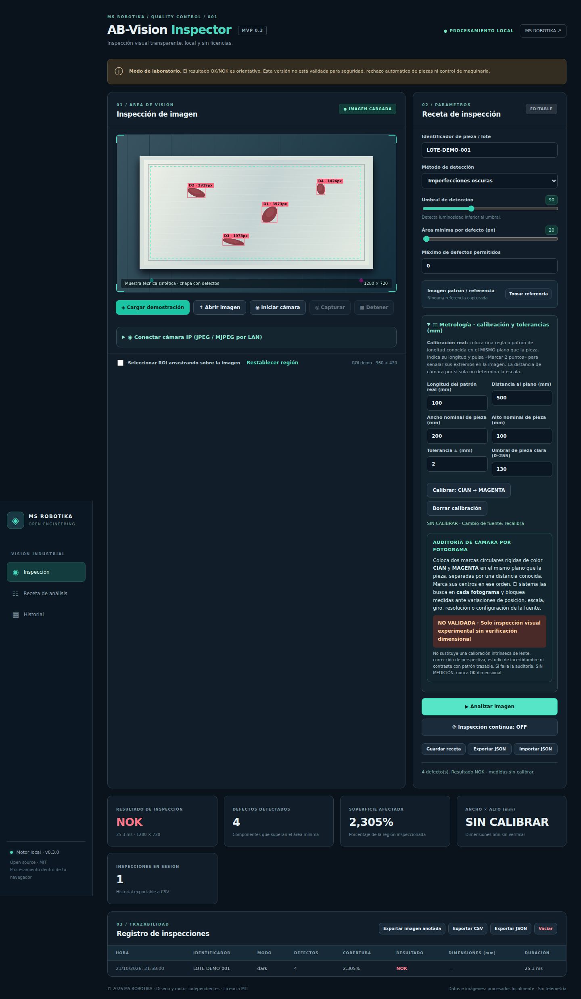
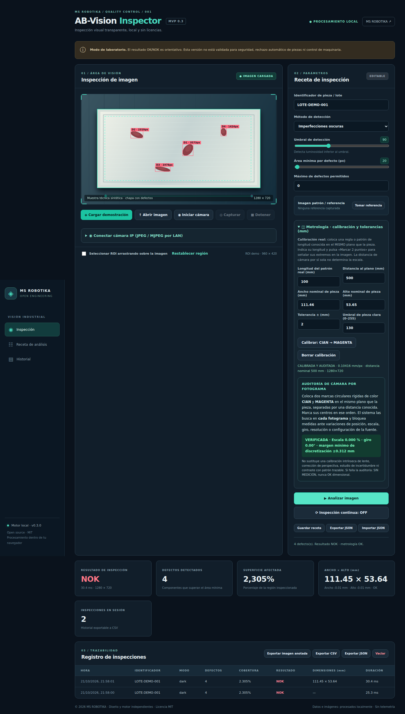
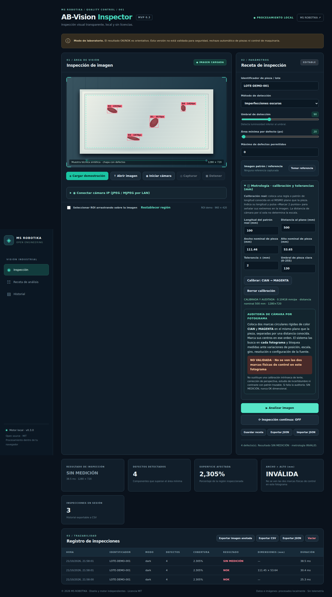
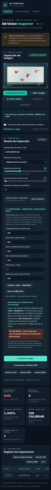

# AB-Vision Inspector · MS ROBOTIKA

**Software gratuito y open source · MIT · v0.3 alfa de laboratorio**

Aplicación original de inspección visual local en español. Esta **rama de distribución temporal** permite acceder al programa y a sus capturas mientras se crea un repositorio independiente llamado `msrobotika/AB-Vision-Inspector`. No afecta a las ramas principales de otros proyectos.

## Ver y descargar el programa

[**AB-Vision Inspector — aplicación HTML portátil**](AB-Vision-Inspector-PORTABLE.html) · [**Descargar toda esta rama como ZIP**](https://github.com/msrobotika/msrobotika/archive/refs/heads/AB-Vision-Inspector-v0.3.zip)

Descarga el HTML y ábrelo con Chrome, Firefox o Edge. No necesita instalar Python. **La edición portátil no admite cámara IP a través del proxy local**; para esa función se necesita la edición de servidor incluida en el paquete de desarrollo completo. Las cámaras USB compatibles con los permisos del navegador sí pueden utilizarse.

## Capturas reales de Chromium

Se obtienen con [un script reproducible](tools/capture_real_screenshots.py) que ejecuta el HTML real, comprueba cuatro defectos en una imagen sintética, verifica la calibración y provoca una pérdida de patrón. Se generan y publican por [GitHub Actions](.github/workflows/vision-screenshots.yml). Si una imagen aún no aparece, la generación automática está pendiente o ha fallado; **no son maquetas**.

### Inspección de piezas — 4 defectos

### Calibración dimensional auditada

### Bloqueo preventivo de medición

### Diseño adaptable a móvil

## Funciones de esta edición

- Importación local de imágenes, webcam USB cuando el navegador lo permita, modo demostración.
- Detección de defectos con segmentación y componentes conectados en JavaScript propio.
- Clasificación visual OK/NOK, configuraciones y recetas, ROI, modo de inspección repetida.
- Medición aproximada en mm por referencias física cian y magenta, dimensiones nominales y tolerancias.
- Revalidación del patrón en cada fotograma; bloqueo `SIN MEDICIÓN` si falla la auditoría.
- Historial de sesión y exportación de CSV, JSON e imágenes anotadas.

**Metrología:** dos referencias permiten detectar ciertas derivas, pero no compensan por sí mismas distorsión de lente, perspectiva o incertidumbre total. Esta alfa no es un instrumento certificado y no debe controlar mecanismos de rechazo ni funciones de seguridad de maquinaria. Requiere contrastes físicos y validación metrológica antes de usos productivos.

## Autoría, licencia y seguridad

Copyright © 2026 MS ROBOTIKA. [MIT](LICENSE). Los algoritmos, diseño e interfaz se han implementado para este proyecto, sin reutilizar código de aplicaciones comerciales. El código ha sido preparado con asistencia de IA. No se garantiza ausencia de patentes, reclamaciones ni certificación industrial.

Para una publicación completa del proyecto (servidor de cámara IP, pruebas y recursos) se debe migrar el paquete de desarrollo a su futuro repositorio propio. La edición HTML disponible aquí **no contiene el proxy JPEG/MJPEG**.

